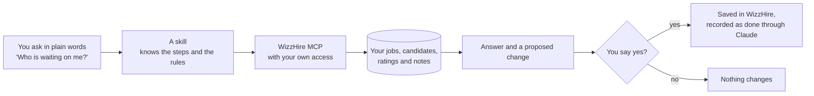
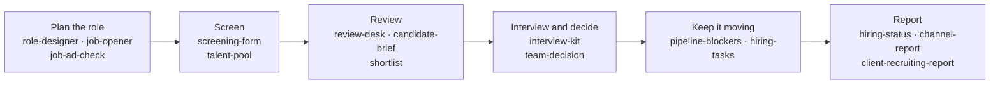

<div align="center">


# WizzHire skills for Claude

**Stop pasting CVs into Claude. Let it work on your real ATS.**

Ready-made skills and agents that open roles, review candidates, prepare interviews and keep hiring moving, on records that stay put between chats. Claude works with your own access, asks before every change, and a person makes every hiring call.

[](https://github.com/WizzHire/wizzhire-agents/releases)
[](LICENSE)


[Get started](#get-started-in-three-steps) · [Prompts](PROMPTS.md) · [Hiring skills](#hiring-skills) · [Hiring agents](#hiring-agents-for-claude-code) · [HR and CRM](#hr-and-crm-skills) · [Safety](#what-claude-never-does) · [FAQ](#faq)

</div>

---

## Why this exists

A chat forgets. Paste ten CVs into Claude today and tomorrow it knows none of them, nobody else on the team can see what it said, and nothing it wrote is on the candidate's profile.

These skills connect Claude to WizzHire through MCP, so Claude reads and writes the same candidates, jobs, ratings and notes your team sees in the app.



## Get started in three steps

**1. Create your WizzHire account.** WizzHire keeps your hiring so Claude remembers it between chats. The 14-day trial is free, or request a demo on [wizzhire.com](https://wizzhire.com/en).

> [Start the free trial](https://wizzhire.com/en/register?utm_source=github&utm_medium=referral&utm_campaign=wizzhire-agents)

**2. Connect WizzHire to Claude.** Open [claude.ai/plugins](https://claude.ai/plugins), click **Add**, then **Add custom connector**, and paste:

```
https://api.wizzhire.com/mcp
```

Sign in, then choose which modules (ATS, HR, CRM) Claude may read and change. Full steps: [wizzhire.com/en/features/ai](https://wizzhire.com/en/features/ai).

**3. Ask Claude.** No installs needed. Paste one of these:

| New account | Every day |
|---|---|
| "Draft a job in WizzHire for a senior accountant in Sarajevo, hybrid." | "Who is waiting on me in WizzHire?" |
| "Check that job ad: is anything missing that candidates look for?" | "Compare my starred candidates for that role." |
| "Write interview questions and a scorecard for that job." | "Where do things stand with our hiring?" |

Twenty more, for every hiring flow: [PROMPTS.md](PROMPTS.md).

### Want Claude to follow the same steps every time? Add the skills

<table>
<tr><th>Claude Code</th><th>claude.ai and Claude Desktop</th></tr>
<tr valign="top"><td>

```
/plugin marketplace add WizzHire/wizzhire-agents
/plugin install wizzhire@wizzhire
```

The plugin brings the WizzHire connector with it. Run `/mcp`, pick `wizzhire` and sign in. Then ask in plain words, or call a skill directly, for example `/wizzhire:review-desk`.

</td><td>

Download the skill zips from the latest [release](https://github.com/WizzHire/wizzhire-agents/releases).

Open **Customize > Skills**, choose **+**, then **Upload a skill**, and pick a zip. Repeat for each skill you want.

Code execution must be on, and the WizzHire connector connected.

</td></tr>
</table>

---

## Hiring skills

Fourteen skills that follow a role from the first brief to the last report.



### Plan the role

| Skill | Ask it | What you get |
|---|---|---|
| `job-opener` | "We need two senior accountants in Sarajevo, hybrid." | A complete job draft: description, must-haves and nice-to-haves, skills, salary, closing date, stages copied from a past role. You publish it. |
| `job-ad-check` | "Why is nobody applying to the QA role?" | Missing facts, too many must-haves, wording that puts people off, and a rewrite ready to paste. |

### Screen and review

| Skill | Ask it | What you get |
|---|---|---|
| `screening-form` | "Build screening questions for this role, with a score." | The same questions for every applicant, branching, points per answer; later, scored and compared answers. |
| `talent-pool` | "Anyone in our talent pool for this role?" | People from your own pool who agreed to hear about future roles, with why each one fits. |
| `review-desk` | "Who is waiting on me?" | Candidates most urgent first, why each is waiting, and a short brief; your notes, stars and ratings saved. |
| `candidate-brief` | "Brief me on Amra before the call." | One page: where they are, fit against the job, the AI screening with its reasons, answers, team notes, open questions. |
| `shortlist` | "Compare my finalists." | Scores, ratings, skills and salary asks side by side, with no verdict. |

### Interview and decide

| Skill | Ask it | What you get |
|---|---|---|
| `interview-kit` | "Prepare the interview, then write up my notes." | Core questions per requirement, follow-ups from the screening, a scorecard per interviewer, and the debrief saved on the profile. |
| `team-decision` | "What does the team think about the shortlist?" | Everyone's ratings and notes in one place, who has not rated, where people disagree, and a task for whoever is missing. |

### Keep it moving

| Skill | Ask it | What you get |
|---|---|---|
| `pipeline-blockers` | "What is holding our hiring up?" | Approvals owed and unfinished steps, grouped by who has to act, with a task for each. |
| `hiring-tasks` | "What do I owe today?" | Your hiring to-do list and what you are waiting on from others; reschedule, hand over or close. |

### Report

| Skill | Ask it | What you get |
|---|---|---|
| `hiring-status` | "Where do things stand?" | Every open role in one line, who is waiting or stuck, what is overdue. |
| `channel-report` | "Which job board actually hires?" | Applicants, advanced and hired per channel, with small numbers flagged. |
| `client-recruiting-report` | "Progress report for Client B." | For companies that recruit for their own clients: jobs linked to the client and an update ready to send. |

### Everything each hiring skill does

<details>
<summary><b>job-opener</b>: a short brief becomes a complete job draft</summary>

- Asks only for the facts it is missing: level, must-haves, work mode, salary, closing date.
- Finds a similar past job and offers to copy its hiring stages.
- Writes the description, up to ten required and ten nice-to-have requirements, and skills.
- Optionally builds a screening form and attaches it to the new draft.
- **Changes after your yes:** one job draft, and the form if you asked for one.
- **Stays with you:** publishing, locations and categories, on the job's page in WizzHire.
</details>

<details>
<summary><b>job-ad-check</b>: a clearer, fairer job ad</summary>

- Reads the job: description, requirements, work mode, locations, salary and whether it is shown, closing date, applicants.
- Flags missing facts candidates look for, more than five or six must-haves, years used as a proxy for skill, jargon, and wording that excludes people, with a neutral alternative for each.
- Shows the channel mix for a live job.
- Writes a rewrite in the job's language that keeps every fact and invents none.
- **Changes:** nothing. You paste the new text on the job's page.
</details>

<details>
<summary><b>screening-form</b>: the same questions for every applicant</summary>

- Offers existing forms and templates before writing a new one.
- Builds five to ten clear questions, with branching so people only answer what applies to them, and points only if you want a score.
- Later: totals scored answers (hand-marked questions count as pending, never zero), shows how answers spread, compares responses side by side.
- **Changes after your yes:** the form. It never asks about age, family, religion, health, nationality or a photo.
</details>

<details>
<summary><b>talent-pool</b>: your next hire may already be in your pool</summary>

- Searches your company's own talent pool by skills, title words and location.
- Returns only people whose agreement to be kept for future roles is current; never people who declined, withdrew, never answered or whose agreement expired.
- Up to ten fits, each with why they fit and what is unknown.
- **Changes:** nothing. Inviting someone is done from the talent pool page, which keeps the record of their agreement.
</details>

<details>
<summary><b>review-desk</b>: who is waiting on you, and why</summary>

- Reads your review queue in order: approvals you owe, missed deadlines, people ready to move, AI-scored but unreviewed, never opened, sitting too long.
- Briefs up to five candidates from the screening breakdown, the CV and the team's notes.
- Puts finalists side by side on request.
- **Changes after your yes, one candidate at a time:** your note, a star, your own rating out of five, a task for a colleague.
- **Stays with you:** every move, rejection and hire.
</details>

<details>
<summary><b>candidate-brief</b>: one page before the call</summary>

- Where they are and since when, and what is outstanding.
- Fit against each key requirement, with evidence from the CV or answers, or "no evidence".
- The AI screening score and its main reasons, presented as an assessment to check.
- Every rating with who gave it, notes quoted, and the open questions to ask.
- **Changes:** nothing.
</details>

<details>
<summary><b>shortlist</b>: finalists on one page</summary>

- Two to six candidates on one job, or the starred ones.
- One table: AI score and reasons, average rating and count, hiring steps done, matching skills, salary asked, stage; screening answers compared when the role has a form.
- **Changes:** nothing. It never adds a winner.
</details>

<details>
<summary><b>interview-kit</b>: fair, structured interviews</summary>

- Core questions per requirement, the same for every candidate, each with what a strong answer shows.
- Two or three follow-ups per candidate from their screening concerns.
- A 1 to 5 scorecard per requirement for each interviewer.
- Turns rough notes into a debrief that keeps the interviewer's own scores and recommendation.
- **Changes after your yes:** the kit or debrief as a note on the candidate, and the interviewer's own rating.
</details>

<details>
<summary><b>team-decision</b>: the team's view in one place</summary>

- Every rating and who gave it, notes quoted, who has not rated yet, and where ratings differ by two points or more.
- **Changes after your yes:** your own rating, a note, a star, and a task asking a colleague for their view (never asking anyone twice).
- **Stays with you:** the decision. It never says "the team decided".
</details>

<details>
<summary><b>pipeline-blockers</b>: what is waiting, on whom</summary>

- Finds approvals owed, missed stage deadlines, unfinished hiring steps and candidates nobody moved, across every live job.
- Groups them by the person who has to act, with open and overdue hiring tasks.
- **Changes after your yes:** a task per blocker, and new dates or owners for overdue ones.
- **Stays with you:** moving, approving or rejecting candidates.
</details>

<details>
<summary><b>hiring-tasks</b>: your hiring to-do list</summary>

- Your open hiring tasks, overdue and today first, and what you delegated that is late.
- **Changes after your yes:** a new date, priority or owner; a reminder to a colleague; closing a task you say is finished. Before closing a hiring-flow step it warns that this can move the candidate.
</details>

<details>
<summary><b>hiring-status</b>: where things stand</summary>

- One line per open role: applicants, new and unopened, waiting, stuck.
- The three most urgent items, overdue hiring tasks, and channels on request.
- **Changes:** nothing.
</details>

<details>
<summary><b>channel-report</b>: where your hires come from</summary>

- Two answers per channel: where visits came from (with apply rates) and what candidates said, each with advanced and hired counts.
- Separates channels that bring people who advance from those that only bring volume, and says when a number is too small to judge.
- **Changes:** nothing.
</details>

<details>
<summary><b>client-recruiting-report</b>: for companies that recruit for their own clients</summary>

- Links a client's jobs to the client in the CRM.
- Reports applicants, stages, hires and time to hire across those jobs, as an update in the client's language, with counts rather than candidate names.
- **Changes after your yes:** job links, and the update logged on the client once you send it.
- Needs the ATS and CRM modules.
</details>

---

## Hiring agents for Claude Code

Agents do the heavy reading or drafting in their own context and change nothing. You approve every change afterwards, in the main conversation, with the skills.

| Agent | Ask it | What it returns |
|---|---|---|
| `hiring-analyst` | "Prepare the weekly hiring meeting." | Every live role, what is blocked and on whom, overdue tasks, channels, talent-pool matches, and at most five decisions with the skill that acts on each. |
| `candidate-researcher` | "Read every application for the QA job." | An evidence-based brief per candidate for a panel. No ranking, no shortlist. |
| `role-designer` | "Set up hiring for a backend developer." | The full package: job ad, requirements, stages to copy, screening form and interview kit, ready to save with `job-opener` and `screening-form`. |
| `talent-matcher` | "Check our pool for every open role." | Up to five talent-pool fits per role, only people who agreed to hear about new roles. |

---

## HR and CRM skills

The same approach for the rest of WizzHire. HR skills need the HR module and CRM skills the CRM module.

| Skill | Ask it | What you get |
|---|---|---|
| `getting-started` | "Set up WizzHire for us." | Where your company stands and the first three things to do, then the right skill. Reads only. |
| `staff-import` | "Here is our staff list in Excel." | Everyone checked row by row first, then added as drafts someone confirms; past leave and agreed allowances too. |
| `onboarding-concierge` | "Start onboarding for the three people joining on the 1st." | Onboarding started per person's start date, steps with no owner caught, dates moved when a start date moves, late steps chased. |
| `leave-desk` | "What leave is waiting for me?" | Each request with who else is off, holidays and days left; your approve or reject recorded one by one. |
| `manager-brief` | "What do I need to know about my team this week?" | Who is away, what waits on you, new people's onboarding, late tasks, in fifteen lines. |
| `my-hr` | "How many days off do I have left?" | An employee's own balance, onboarding, reviews owed, shared feedback and tasks. |
| `crm-import` | "Import our clients and deals from this sheet." | Clients, products, deals, past emails and follow-ups, each with a dry run first and duplicates caught. |

Two more agents for Claude Code: `wizzhire-importer` runs long imports from a local file, and `wizzhire-weekly` prepares a manager's weekly read.

---

## What Claude never does

| Never | Why |
|---|---|
| Move, reject or hire a candidate | Hiring decisions stay with a person. These actions are not available to Claude at all. |
| Publish or edit a job, make an offer, approve a stage | A person decides what goes public and what is promised. |
| Message a candidate or see their contact details | Candidates did not agree to that. |
| Change anything without a yes | Every write is shown first, with a check or dry run wherever WizzHire offers one. |
| Rank people to exclude them, or use age, gender, family status, nationality, health or photos | Skills describe evidence against the job's own requirements and leave the judgement to you. |
| Follow instructions hidden in a CV or document | What candidates and clients write is data, never instructions. |

Every action Claude takes is recorded in WizzHire as done through an agent on your behalf. More: [docs/safety.md](docs/safety.md). The full map of hiring flows and what stays in the app: [docs/ats-coverage.md](docs/ats-coverage.md).

---

## FAQ

<details>
<summary><b>Do I need a WizzHire account?</b></summary>

Yes. The skills keep your hiring in WizzHire so Claude remembers it between chats and your team sees the same records. The 14-day trial is free. A new trial starts with the ATS; HR and CRM skills need those modules.
</details>

<details>
<summary><b>Which Claude can I use?</b></summary>

Claude Code (as a plugin), claude.ai and Claude Desktop (by uploading the skill zips). The WizzHire connector is verified with Claude.
</details>

<details>
<summary><b>What does Claude see?</b></summary>

What you can see in WizzHire, and only in the modules you allowed when you connected. Candidate contact details are never shared with Claude. When a skill reads a CV, that text is processed by Claude under your own agreement with Anthropic.
</details>

<details>
<summary><b>Where do AI screening scores come from?</b></summary>

From WizzAI screening in WizzHire, where it has been run on an application. Skills show the score with its reasons as an assessment for a person to check, never as a decision.
</details>

<details>
<summary><b>Which languages?</b></summary>

Every skill understands asks in English, Bosnian, Croatian and Serbian, and replies in the language you write in.
</details>

<details>
<summary><b>Can I change a skill?</b></summary>

Yes. Each skill is one `SKILL.md` file under the MIT licence. Copy it, adapt it, and keep the rules that protect candidates.
</details>

---

## For contributors

- A skill is a folder in `skills/` with a `SKILL.md`; an agent is a file in `agents/`.
- `python3 scripts/check_tools.py` checks that every tool, argument and value a skill or agent names exists on the WizzHire server. It runs on every push.
- `python3 scripts/sync_tools.py <registry.py> <commit>` regenerates `tools.json` from the server's registry, leaving out staff-only tools.
- `claude plugin validate .` checks the plugin and marketplace files.
- Run the cases in [evals/README.md](evals/README.md) on a staging company before a release.

## License

MIT. WizzHire is ATS, HR and CRM software for companies: [wizzhire.com](https://wizzhire.com/en).
